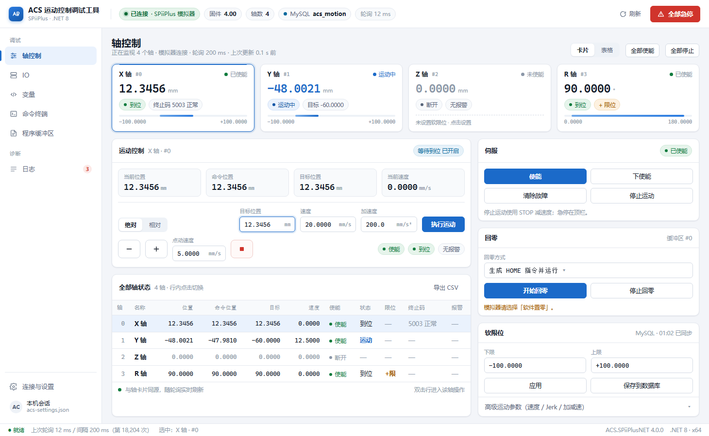

# ACS 运动控制调试工具 · 界面改版方案 v1

> 状态：**P0/P1/P2 已落地**（2026-11-06），其余页面按第 8 节计划继续。
>
> 视觉预览：[`mockup-main.png`](mockup-main.png)（1460×900，与当前窗口默认尺寸一致）｜可交互源文件：[`mockup-main.html`](mockup-main.html)
> 实机截图：[`wpf-axis.png`](wpf-axis.png)（模拟器，4 轴）

---

## 0. 落地进度（2026-11-06）

已实现并实机跑通（模拟器：初始化 → 主界面）：

| 范围 | 内容 |
| --- | --- |
| **P0 设计系统** | `Themes/Tokens.xaml`（色板/字体/图标）、`Themes/Controls.xaml`（按钮 6 变体、输入框、复选框、分段单选、卡片、胶囊、左侧导航、分段页签、表格行）；HandyControl 3.5.1 作为控件基座（主题合并 + 后续 Dialog/Growl/StepBar 备用） |
| **P1 主框架** | 左侧导航（7 页，图标+选中态）、顶栏设备状态条（连接/轴数/数据库/轮询 + 全局急停）、底部状态栏（轮询健康度） |
| **P2 轴控制页** | 4 张轴卡片（位置/状态点/状态胶囊/报警/限位）＋ 操作台（**手动 / 回零 / 设置**）＋ 常驻动作条（使能/下使能/清故障/停止/急停本轴）＋ 右侧轴状态（大号位置、遥测、提示） |
| **P2+ 手动九宫格** | 手动页改为 3×3：中间十字 X/Y、左上/左下 R（逆/顺）、右上/右下 Z（升/降）、中心停止；三种模式 **步进（默认）/ 连续 / 绝对**；步长共用、速度分 XY/Z/R 三组；绝对模式九宫格禁用、X/Y 一起走；单轴定位跟随选中轴。删除原点动/定位两个分段（"全部轴状态"表也一并去掉，轴卡片已含该信息）。左列底部固定「最近日志」5 条（按级别着色）。实机截图：[`wpf-manual.png`](wpf-manual.png) |
| **P3 其余页面** | IO：按端口分组 LED + 十六进制值；变量：读写卡 + 监视列表；终端：快捷查询 + 深色输出面板；程序：工具条 + 等宽编辑器；日志：四列 + 级别/关键字过滤 + 自动滚动；连接与设置：连接 / 设备 / 数据库三张卡 + 协议分段。截图：[`wpf-io.png`](wpf-io.png)、[`wpf-vars.png`](wpf-vars.png)、[`wpf-terminal.png`](wpf-terminal.png)、[`wpf-program.png`](wpf-program.png)、[`wpf-log.png`](wpf-log.png)、[`wpf-connection.png`](wpf-connection.png) |

针对“更容易操作”新增的交互：

- **按任务分方式**：点动 / 定位 / 回零 / 设置 四个分段，一次只面对一件事，不再是一个长表单；
- **点动**：两个 148×56 大按钮（负/正方向）+ 独立停止键；“± 一步”按步进量走一段自动停，适合微调；
- **定位**：绝对/相对用分段控件切换，只保留一个「执行运动」主按钮；「取当前」把实际位置填进目标，避免手抄；
- **常驻动作条**：使能/下使能/清故障/停止固定在操作台底部，不随方式切换消失；「急停本轴」独立红色描边；
- **轴切换**：点卡片即换轴，选中卡片蓝色描边；
- **顶栏急停常驻**，任何页面都能一键全停；
- 状态语义：`未使能 / 到位 / 运动 / 未到位`，5003 等正常终止码不标红。

尚未完成（按计划）：

- **P3**：IO（端口分组 LED）、变量、命令终端、程序缓冲区、日志四列筛选；
- **P4**：连接与设置页、初始化窗口统一风格；
- **P5**：快捷键、空态/错误态、忙碌态、1366×768 紧凑模式与回归。

> 说明：全局样式换新后，旧页面（IO/变量/终端/程序/日志/连接）仍沿用原布局，控件外观已随主题更新，但信息结构与轴页不在一个水平，属 P3/P4 范围。

---

## 1. 为什么现在"不直观、不美观"

问题不在"配色不好看"，而在**信息层级和控件语言都是默认值**。逐条对应现在的代码：

| # | 现象 | 位置 | 造成的后果 |
| --- | --- | --- | --- |
| 1 | 7 个 Tab 平权，且"连接"（低频配置）排在第一位 | `MainWindow.xaml:27-49` | 每次打开先看到配置表单，真正高频的轴操作要点第二下 |
| 2 | 全局状态只有底部一行字：连接 / 选中轴 / 轮询 | `MainWindow.xaml:9-25` | 固件版本、轴数、数据库是否就绪、有无报警，都要切页去翻 |
| 3 | 全部控件是 WPF 默认模板，全局样式只有 6 条间距 Setter | `App.xaml:12-38` | 按钮/输入框/下拉框都是系统灰，像 2010 年的 WinForm |
| 4 | 右栏 6 个 GroupBox 流水线堆叠，20+ 行"标签＋输入框＋按钮" | `AxisView.xaml:96-266` | 视线没有落点，找"急停"和找"原点偏移"花的时间一样 |
| 5 | 轴表 10 列纯文本，数字不右对齐、不等宽；报警/运动只靠整行底色 | `AxisView.xaml:47-83` | 数值一晃就变宽窄，拍屏/截图后无法对齐比较 |
| 6 | 危险操作只靠浅黄背景 `#FFE0A0` 区分，和普通按钮同尺寸 | `AxisView.xaml:40,109` | 急停不够醒目，容易点错相邻按钮 |
| 7 | IO 页 64 个 CheckBox 平铺，无端口分组、无状态灯语 | `IoView.xaml:22-35` | 现场排查"是哪个端口的第几位"要靠数 |
| 8 | 日志是单行拼接文本 `[时间] [级别] [来源] 内容` | `LogView.xaml:17-19`、`LogService.cs:25` | 级别不可扫读，找一条 Error 要肉眼过滤 |
| 9 | 初始化窗口手写一套颜色字号，与主界面风格不统一 | `InitializationWindow.xaml:8,18,73` | 启动第一屏和主界面像两个软件 |
| 10 | 没有空态/错误态/忙碌态规范 | 全局 | 未连接时页面是"死表单"，报错靠日志和 MessageBox |

**一句话总结**：功能齐全，但界面是"控件堆放"，不是"操作台"。

---

## 2. 设计目标与原则

改版只做三件事：**让状态可扫读、让动作有主次、让外观统一**。

1. **3 秒判断**：打开就能看到"连没连上、几个轴、谁在动、有没有报警、数据库是否就绪"。
2. **1 次点击**：高频动作（使能、点动、停止、急停）不藏在二级面板里。
3. **危险可见但不易误触**：急停常驻顶栏、红色实心；危险动作（重启控制器、全部下使能）二次确认；普通动作不弹窗。
4. **不改业务逻辑**：只改 View（XAML）与最多 3~4 个展示属性；`Core` / `Data` 一行不动，绑定名保持兼容。
5. **现场可用**：1366×768 不掉功能（紧凑模式＋面板内滚动），1920×1080 不缺留白。

---

## 3. 视觉语言（Design Tokens）

方向：**浅色工业仪表风**——中性冷灰底、白色卡片、克制的单一主色，语义色只在状态上出现。

### 3.1 色彩

| 用途 | Token | 值 | 说明 |
| --- | --- | --- | --- |
| 页面底色 | `--bg` | `#F3F5F9` | 冷灰，衬托白卡片 |
| 卡片/面板 | `--surface` | `#FFFFFF` | |
| 次级底色 | `--surface-2` | `#F8FAFC` | 表头、KPI 底、输入区隔 |
| 分隔/描边 | `--border` | `#E4E8EF` | 1px，不用重阴影 |
| 主文字 | `--text` | `#121A26` | |
| 次要文字 | `--text-2` | `#57657A` | |
| 辅助文字 | `--text-3` | `#8B97A8` | 单位、说明、占位 |
| 主色 | `--brand` | `#1B6AC9` | 选中态、主按钮、运动中 |
| 主色深 | `--brand-dark` | `#1557A8` | hover / 文字 |
| 主色浅底 | `--brand-soft` | `#EAF2FD` | 选中行、运动胶囊 |
| 成功 | `--ok` | `#0F7B3D` | 使能、到位 |
| 警告 | `--warn` | `#A85B00` | 限位、提示、待处理 |
| 危险 | `--danger` | `#D0342C` | 急停、故障 |
| 信息 | `--info` | `#0A6A9E` | 数据库、提示条 |

**语义约定（重要）**：`5003 等 5000~5008 终止码` 属"正常终止"，一律**灰色中性胶囊**，只有 5009+ / 驱动器报警才用红色——避免现在"整行变红"的误判感。

### 3.2 字体

| 场景 | 字体 | 字号/字重 |
| --- | --- | --- |
| 界面正文 | 微软雅黑 UI（回退 Segoe UI） | 13px / 400 |
| 页面标题 | 同上 | 20px / 600 |
| 卡片标题 | 同上 | 13px / 600 |
| 辅助说明 | 同上 | 11.5px / 400，`--text-3` |
| **数值/坐标** | Cascadia Mono → Consolas | 18~24px / 600，`tabular-nums` |
| 终端/程序/日志 | 同上等宽 | 12.5~13px |

数值一律等宽＋右对齐，这是"仪表感"的关键：轴位置从 `-48.0021` 跳到 `12.3456` 时不会抖动。

### 3.3 间距、圆角、阴影

- 间距阶梯：**4 / 8 / 12 / 16 / 24 / 32**；卡片内边距 12，卡片间距 14，页面内边距 18~20。
- 圆角：控件 6px、卡片 10px、胶囊 999px。
- 阴影：静态 `0 1px 2px rgba(16,24,40,.05)`；选中/悬浮 `0 4px 12px rgba(16,24,40,.07)`。**不用大投影**，靠描边分层。
- 控件高度：按钮 32（紧凑 28）、输入框 32、表格行 32~34。
- 图标：线性 1.8px 描边，16px 栅格；用系统 `Segoe Fluent Icons`/`Segoe MDL2 Assets`，**不引第三方图标包**。

### 3.4 效果预览



---

## 4. 信息架构

```
┌──────────────────────────────────────────────────────────────────────────────┐
│ 品牌 │ ● 已连接·模拟器  固件 4.00  轴数 4  MySQL acs_motion  轮询 12ms │ 刷新 急停 │
├──────────┬───────────────────────────────────────────────────────────────────┤
│ 调试      │  页面标题 / 副标题                         视图切换  批量动作     │
│ ▸ 轴控制  │ ┌轴卡┐ ┌轴卡┐ ┌轴卡┐ ┌轴卡┐                                    │
│   IO      │ ┌──────────────────────────────┬──────────────────────────┐    │
│   变量    │ │ 运动控制（KPI＋定位＋点动）    │ 伺服 / 回零 / 软限位     │    │
│   终端    │ ├──────────────────────────────┤                          │    │
│   程序    │ │ 全部轴状态表                  │ 高级参数（折叠）         │    │
│ 诊断      │ └──────────────────────────────┴──────────────────────────┘    │
│   日志 ③  │                                                                   │
│ ────────  │                                                                   │
│ 连接与设置│                                                                   │
├──────────┴───────────────────────────────────────────────────────────────────┤
│ ● 就绪 │ 轮询 12ms/200ms │ 选中 X 轴 │              ACS.SPiiPlusNET 4.0.0 · .NET 8 │
└──────────────────────────────────────────────────────────────────────────────┘
```

**四个结构性改动**

1. **TabControl → 左侧导航**：腾出上下空间，页签数量可以继续加；当前项用浅蓝底＋左侧 3px 主色条。
2. **顶栏变成"设备状态条"**：连接对象、固件、轴数、数据库、轮询耗时全部常驻；右侧固定「刷新」与红色「全部急停」。
3. **默认落在"轴控制"**：连接/设置降为底部入口（低频），未连接时页面内给出"去连接"引导，而不是强制先看表单。
4. **轴卡片总览**：4~8 轴时一屏看清全部轴的位置与状态，点卡片即切换操作对象；轴数多时自动退化为紧凑表格（见 5.1）。

---

## 5. 逐页方案

### 5.1 轴控制（核心页，优先做）

```
┌ 轴控制 ── 4 轴 · 模拟器 · 轮询 200ms ────────────────── [卡片|表格] [全部使能] [全部停止] ┐
│ ┌ X轴 #0 已使能 ─────┐ ┌ Y轴 #1 运动中 ─────┐ ┌ Z轴 #2 未使能 ────┐ ┌ R轴 #3 已使能 ───┐ │
│ │ 12.3456 mm         │ │ -48.0021 mm  (蓝)  │ │ 0.0000 mm (灰)     │ │ 90.0000 °        │ │
│ │ [到位][5003 正常]  │ │ [运动中][目标…]    │ │ [断开][无报警]     │ │ [到位][+限位]    │ │
│ │ ├────●────┤ 软限位 │ │ ├─●──────┤         │ │ 未设置软限位       │ │ ├──────●──┤      │ │
│ └────────────────────┘ └────────────────────┘ └────────────────────┘ └──────────────────┘ │
│ ┌ 运动控制 · X轴 #0 ──────────────────────────────── [等待到位 已开启] ┐ ┌ 伺服 ────────┐ │
│ │ 当前位置    命令位置    目标位置    当前速度                        │ │ [使能][下使能]│ │
│ │ 12.3456mm   12.3456mm   12.3456mm   0.0000mm/s                      │ │ [清故障][停止]│ │
│ │ ─────────────────────────────────────────────────────────────────── │ └──────────────┘ │
│ │ [绝对|相对] 目标[12.3456] 速度[20] 加速度[200] (执行运动)            │ ┌ 回零 ────────┐ │
│ │ (−) (+) 点动速度[5.0000] (■)          [使能][到位][无报警]           │ │ 方式 ▾       │ │
│ └──────────────────────────────────────────────────────────────────────┘ │ [开始][停止] │ │
│ ┌ 全部轴状态 ──────────────────────────────── 导出 CSV ─┐              └──────────────┘ │
│ │ 轴 名称 位置 命令位置 目标 速度 使能 状态 限位 终止码 报警│              ┌ 软限位 ──────┐ │
│ │ 0  X轴 12.3456 …   ●使能  到位  —  5003正常 —          │              │ 下限/上限    │ │
│ │ …                                                       │              │ [应用][存库] │ │
│ └─────────────────────────────────────────────────────────┘              │ 高级参数 ▾   │ │
└──────────────────────────────────────────────────────────────────────────└──────────────┘
```

要点：

- **轴卡片**：轴名/编号/使能状态/大号位置/状态胶囊/软限位区间条。选中卡片蓝描边＋2px 顶部主色条。轴数 > 8 时自动切为横向紧凑条或直接落到表格视图。
- **KPI 四联**：位置 / 命令位置 / 目标位置 / 速度，等宽大字；运动中数值用主色。
- **定位表单**：绝对/相对用分段控件（比下拉框少一次点击）；目标、速度、加速度一行放完，主按钮「执行运动」贴在最右。
- **点动**：`−` / `+` 两个 46×38 大按钮（现场可能戴手套/触摸），中间是点动速度，旁边是红色描边停止。
- **状态胶囊**：使能/到位/无报警/终止码，用颜色表达，不再写"使能=True"。
- **右栏**：伺服 2×2、回零、软限位，三张卡固定，避免原来 6 个 GroupBox 的纵向长卷；高级运动参数折叠，需要时再展开。
- **表格视图**：保留现有 10 列信息（现场仍需要横向对比），改为等宽右对齐数值、状态点、无斑马纹的浅分隔线；选中行浅蓝。卡片/表格用分段控件切换，记住上次选择。
- **批量动作**：全部使能/停止留在页头；「全部急停」在顶栏常驻（它属于全局，不属于某一页）。

### 5.2 IO

```
┌ 数字输入 ───────────────┐ ┌ 数字输出（点击切换） ──────────┐
│ 端口 0  0x0F3A           │ │ 端口 0  0x0003                 │
│ ●●●● ○○○○ ●●○○ ●●●●      │ │ ○●○○ ○○○○ …（点击即写硬件）    │
│ 端口 1  …                │ │ 端口 1  …                      │
└──────────────────────────┘ └────────────────────────────────┘
┌ 整端口 / 模拟量 ────────────────────────────────────────────┐
│ 端口[0] 值[0x00FF] [写端口]   模拟输出[1234] [写] [读模拟输入] │
└─────────────────────────────────────────────────────────────┘
```

- 按**端口分组**，每端口一张卡：端口号 + 当前十六进制值 + 16 个 LED 圆点（亮=主色，灭=灰）。
- 输入只读（圆点不可点、鼠标不变手型）；输出可点，按下即写，写失败该点闪红并进日志。
- 顶部给"按端口过滤 / 只看输出"的轻量筛选，64 点不再靠数格子。
- 保留 GridSplitter 的上下/左右可调比例（现场有人喜欢大图）。

### 5.3 变量

```
┌ 读写 ──────────────────────────────────────────────────────────┐
│ 变量[FPOS(0) ▾] [读取]  写入值[123.45] [写入] [加入监视]        │
│ [声明实数] [声明整数]          提示：支持 FPOS、MST(0)、MyArr(10) │
└────────────────────────────────────────────────────────────────┘
┌ 监视列表 ──────────────── 自动刷新 [200ms ▾]  搜索[____] ─────┐
│ 变量名            当前值                 操作                  │
│ FPOS(0)           12.3456                [删除]                │
│ MST(0)            1                      [删除]                │
└────────────────────────────────────────────────────────────────┘
```

- 变量名做成可编辑下拉（历史记录），减少重复输入。
- 监视表等宽右对齐；错误行浅红＋行内显示错误原因，而不是只变黄。
- 增加搜索框与刷新间隔选择（复用现有刷新逻辑）。

### 5.4 命令终端

```
┌ 快捷查询 ─────────────────────────────────────────────────────┐
│ [?FPOS(0)] [?MST(0)] [?RPOS(0)] [?APOS(0)] [?VEL(0)] [?IN(0)] …│
└────────────────────────────────────────────────────────────────┘
┌ 输入 ─────────────────────────────────────────────────────────┐
│ > ?FPOS(0)                                  [执行] [下发] [清空]│
└────────────────────────────────────────────────────────────────┘
┌ 输出（等宽，深色面板）────────────────────────────────────────┐
│ 12:31:02.114  → ?FPOS(0)                                       │
│ 12:31:02.118  ← 12.3456                                        │
└────────────────────────────────────────────────────────────────┘
```

- 交互式终端观感：提示符 `>`、命令回显浅灰、应答白色、错误红色；↑/↓ 翻历史（需 VM 加一个历史列表，约 20 行代码）。
- 输入框自动聚焦，`Ctrl+Enter` 执行、`Enter` 执行（可选）、`Esc` 清空输入。
- 输出区可复制选中文本。

### 5.5 程序缓冲区

```
┌ 缓冲区 [0 ▾]  [上传] [下载(覆盖)] [编译] [运行] [停止] [插入模板] ┐
│ 状态：已编译 · 1.2 KB · 更新于 12:30                [只读/编辑]  │
├──────────────────────────────────────────────────────────────────┤
│ 1  ! HOME program                                                │
│ 2  X0 = 0                                                        │
│ …                                                                │
└──────────────────────────────────────────────────────────────────┘
```

- 行号 + 等宽编辑区（行号列可用 `ItemsControl` 与 TextBox 同步滚动实现，或先不做行号）。
- 缓冲区号下拉（0~63），状态行显示"已编译/空/大小"。
- 危险动作「下载(覆盖)」二次确认；「运行」前若缓冲区为空则就地提示。

### 5.6 日志

```
┌ [全部] [信息] [警告] [错误]  搜索[______]  自动滚动 ●  [清空] [保存] ┐
│ 12:31:02.114  信息  UI    ACS 调试工具已启动                          │
│ 12:31:02.118  警告  轴    X 轴接近软限位                              │
│ 12:31:02.120  错误  ACS   5009 运动故障：跟随误差超限                  │
└──────────────────────────────────────────────────────────────────────┘
```

- 四列：时间 / 级别（彩色圆点＋文字）/ 来源 / 内容；级别筛选做成胶囊按钮，带计数。
- 行高 28，错误行浅红底、警告行浅黄底；`自动滚动` 变成开关样式，用户向上翻时自动暂停。
- 顶部保留"已丢弃 N 条"的提示（现有 LogService 已有该能力）。

### 5.7 连接与设置

- 从首页 Tab 改为左侧底部入口，标题「连接与设置」。
- 三段式卡片：**连接**（模拟器/IP/协议/超时 → 连接·断开）、**设备**（控制器信息、轴数、IO 规模、重启、存 Flash）、**数据库**（启用开关、参数、测试/建表、自动保存开关）。
- 连接状态在页面顶部用一条 InfoBar 呈现："已连接 SPiiPlus 模拟器 · 固件 4.00 · 4 轴"，未连接时是"未连接，点此连接"的可点击条。
- 数据库"测试连接/初始化"结果显示成行内状态胶囊，而不是一行蓝字。

### 5.8 初始化窗口

- 与主界面统一：同一套配色与字体，标题区加品牌标记；步骤列表改为**竖向步骤条**（圆点＋连线，完成打勾、进行中主色、失败红）。
- 右侧状态卡保留（它其实很好用），加上"ACS 初始化成功"大字＋当前连接对象＋数据库信息；底部按钮固定右下。
- 窗口 880×620 不变，避免现场小屏放不下。

---

## 6. WPF 落地方式（不引第三方 UI 库）

### 6.1 新增资源字典

```
src/AcsMotionTool.App/Themes/
├─ Tokens.xaml       颜色 / 字体 / 间距 / 圆角 / 阴影（对应第 3 节）
├─ Typography.xaml   标题、正文、辅助、数值、等宽 五套 TextBlock 样式
├─ Controls.xaml     Button / TextBox / ComboBox / CheckBox / ToggleSwitch / ListBox / ScrollBar / ToolTip 模板
├─ Cards.xaml        Card、SectionHeader、KpiTile、Chip、EmptyState、InfoBar
├─ DataGrid.xaml     表头、行、单元格、选中、告警行
└─ Icons.xaml        Segoe Fluent Icons 字形 + Geometry 图标
```

App.xaml 里合并这些字典；现有 4 个转换器保留，另加 `LogLevelToBrush`、`BoolToVisibility`（已有）等 2~3 个。

### 6.2 控件改造清单

| 现有 | 改为 |
| --- | --- |
| `TabControl` + 7 个 `TabItem` | `ListBox` 导航（ItemTemplate：图标＋文字＋徽标）＋ `ContentControl` |
| `GroupBox`（默认外观） | `Card`（自定义模板，保留 Header 语义与 `AutomationProperties.Name`） |
| 默认 `Button` | Primary / Secondary / Danger / Ghost / Icon 五种变体（Style Key 区分） |
| 默认 `TextBox` / `ComboBox` | 统一 32px 高、6px 圆角、聚焦 2px 主色光环 |
| `DataGrid`（默认皮肤） | 重写列头/行/选中模板；数值列 Template 右对齐等宽 |
| `CheckBox`（IO 位） | `ToggleButton` 圆点 LED（开=主色实心，关=灰空心） |
| `ListBox`（日志） | `ListView`/`ItemsControl` 四列模板＋虚拟化 |

> 说明：`ComboBox` 和 `ScrollBar` 的模板必须一并重写，否则一处保留系统皮肤就会"破功"。

### 6.3 需要动的 ViewModel（很少）

| 属性 | 位置 | 用途 |
| --- | --- | --- |
| `IsConnected`（已有） | `ConnectionViewModel` | 顶栏胶囊、页面空态 |
| `AxisCount` / `ControllerInfoText`（已有） | `ConnectionViewModel` | 顶栏"轴数/固件" |
| 新增 `AlarmCount`、`SelectedAxisCount` | `MainViewModel` | 顶栏报警计数、导航徽标 |
| 新增 `CurrentPage` | `MainViewModel` | 导航选中项（也可纯 XAML 用 `ListBox` 本地状态） |
| 新增 `CommandHistory` | `TerminalViewModel` | 终端 ↑/↓ 历史 |
| 新增 `LogFilter`、`Counts` | `LogViewModel` | 日志级别筛选 |

全部是展示层属性，**不碰 `AcsService` / `Core` / `Data` 的行为**。

### 6.4 保留的既有能力

- `GridLayoutBehavior.PersistKey`（分隔条比例持久化）继续用；轴页/IO 页重构后保留 `Grid` 列定义即可。
- 所有命令绑定名保持不变，回归时按现有按钮逐个点。
- `AutomationProperties.AutomationId` 保留在关键控件上（分隔条、急停、主按钮），方便以后再做 UI 自动化。

---

## 7. 交互规范

| 场景 | 规则 |
| --- | --- |
| 快捷键 | `Ctrl+1..7` 切页；`F5` 刷新当前页；`Ctrl+Enter` 终端执行；`Esc` 关闭浮层/清空输入（**不绑定停止**，避免误触） |
| 忙碌态 | 按钮内旋转指示 + 禁用；耗时操作在所属卡片显示进度条，不冻结整页 |
| 校验 | 数字输入就地红框 + 下方 11px 提示；不弹 MessageBox |
| 危险确认 | 急停：**不确认**，立即执行；重启控制器 / 全部下使能 / 写 Flash：自绘确认对话框（标题+对象+后果+取消/确认） |
| 空态 | 未连接：页面中央一张卡"尚未连接控制器 → 去连接 / 用模拟器连接" |
| 错误 | 页面顶部 InfoBar（可关闭）+ 写入日志；只有破坏性操作才用模态 |
| 数据刷新 | 数值等宽；变化时 200ms 背景闪烁（可在设置里关）；鼠标悬停显示完整精度 |

---

## 8. 实施计划

| 阶段 | 内容 | 产出 | 估时 |
| --- | --- | --- | --- |
| P0 | Tokens / Typography / Controls / DataGrid / Chip / Card 样式 | 所有页面"骨架不变但已换皮" | 0.5 天 |
| P1 | 主框架：顶栏状态条 + 左导航 + 状态栏 + 全局急停 | 新外壳可用 | 0.5 天 |
| P2 | 轴控制页：轴卡片、KPI、定位/点动、右栏三卡、表格视图 | 核心页完成 | 1 天 |
| P3 | IO（端口分组+LED）、变量、终端、程序、日志 | 其余 5 页 | 1 天 |
| P4 | 连接与设置页、初始化窗口 | 风格统一 | 0.5 天 |
| P5 | 快捷键/空态/错误态/忙碌态/DPI/回归 | 验收 | 0.5 天 |

合计约 **3.5~4.5 个工作日**（不含你确认与试看反馈的往返）。可先做 P0+P1+P2 给你看一版真机运行效果，再决定后面是否继续。

**验收标准**

- 1920×1080 与 1366×768 下，轴控制页高频动作（使能/点动/定位/停止/急停）均无需滚动即可触达（低分辨率允许表格区滚动）。
- 所有页面无默认 WPF 灰控件残留；轴页/IO 页分隔条拖动与记忆功能保持。
- 现有绑定零破坏：`dotnet build` 0 警告 0 错误；逐页点一遍按钮与前后状态一致。
- 日志级别可筛可读；5003 不显示为故障色。

---

## 9. 风险与取舍

1. **纯 WPF 自绘成本**：约 60% 工作量在控件模板。若允许引入 HandyControl/MaterialDesign，可省 30~40%，但会带来依赖、包体与风格绑定；**默认不建议**，除非你希望更快。
2. **深色主题**：车间强光下浅色更稳；若要深浅双主题，样式需全部走 DynamicResource，工作量 ×1.3。建议先浅色，预留 token 结构。
3. **128 轴场景**：卡片总览只在 ≤8 轴时启用，超出自动切表格并保持虚拟化，避免一次创建 128 个卡片。
4. **布局持久化**：`GridLayoutBehavior` 依赖控件树里的 `Grid` 列；重构时保留列定义或新增 key，避免旧配置失效（失效也只是回到默认比例）。
5. **小屏**：1366×768 采用紧凑模式（间距 12→10、轴卡去掉限位条、右栏可折叠），内容区允许滚动。
6. **现有自动化脚本**：若之前有人依赖 `Splitter_Axis` 等 AutomationId 或窗口标题做脚本，我会保留这些标识与标题。

---

## 10. 需要你拍板

1. **风格**：A 浅色工业风（推荐，即预览稿）｜B 深色仪表风｜C 双主题可切换？
2. **导航重构**：接受"连接"从第一个 Tab 移到左下角、默认进轴控制吗？
3. **目标环境**：主用 1920×1080 还是 1366×768？现场有没有触摸屏（决定按钮尺寸与行高）？
4. **范围**：先做 P0+P1+P2（外壳＋轴控制页）看效果，还是一次性 7 页全改？
5. **依赖**：坚持零第三方 UI 库，还是允许引入（更快但多一个依赖）？

---

*附：预览稿是 HTML 静态示意，仅用于确认视觉方向；正式实现是 WPF 样式与模板，不会引入 WebView。*
